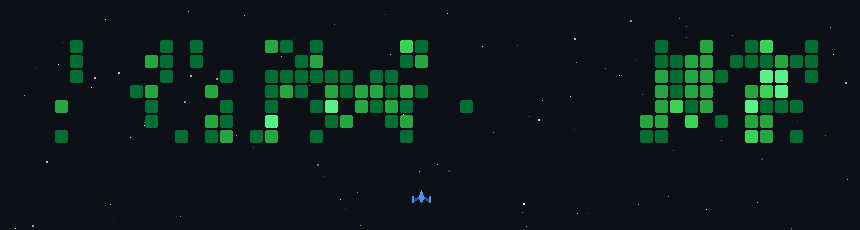

<h1 align="center">👋🏻 ¡Hola! Soy Lucía Fuertes Cruz</h1>

  

 

  
  &nbsp;&nbsp;
  
  &nbsp;&nbsp;
  

---

## 💙 Un poquito sobre mí

Soy estudiante de **2º de Desarrollo de Aplicaciones Web en el IES Luis Vives**.

Me interesa especialmente el **desarrollo backend con C# y .NET**: entender cómo funciona una aplicación por dentro, trabajar con datos y crear soluciones bien estructuradas.

En mis repositorios comparto mis proyectos, prácticas y lo que voy aprendiendo por el camino. Me gusta afrontar nuevos retos, cuidar los detalles y seguir mejorando con cada proyecto. 🚀

> “Programa siempre tu código como si la persona que va a tener que mantenerlo en el futuro fuera un violento psicópata que sabe dónde vives”.
> — Martin Goldin

## 💻 Tecnologías y herramientas

Tecnologías con las que he trabajado durante mi formación y mis proyectos.

### ⚙️ Backend

  

### 🎨 Frontend y contenido web

  

### 🗄️ Bases de datos y caché

  

### 🛠️ Herramientas de desarrollo

  

### 🖥️ Entornos

  

## 📊 Mi actividad en GitHub

  
  

  
  

## 🚀 Mi código, en modo arcade

  

---

  Hecho con curiosidad, paciencia y alguna que otra tecla de más. 💙

